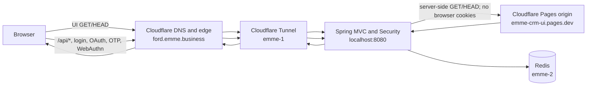

# Ford CRM hosting and request routing

## Decision

Keep React UI in `Ford-web` and Spring backend in `Ford-service`. Ford Service is the only backend runtime and owns APIs and authentication; there is no standalone BFF image. Keep `ford.emme.business` as the browser origin, routed through the existing Cloudflare Tunnel. Spring serves the UI by reverse proxying safe page and asset requests to the Cloudflare Pages origin `emme-crm-ui.pages.dev`.

The browser stays on one origin for UI, API, and authentication. The repositories and deployments remain separate. DNS selects the Tunnel; Tunnel ingress routes application traffic to Spring. Spring then fetches UI documents/assets from Pages server-to-server.

## Request flow



## Path ownership

| Browser request | Tunnel route | Handler | Notes |
|---|---|---|---|
| `GET/HEAD /`, `/login`, application routes, assets | Catch-all `ford.emme.business` → Spring `:8080` | Spring UI proxy → Pages `emme-crm-ui.pages.dev` | Streams Pages response under the public origin; rewrites Pages-origin redirects. |
| `/api/*` | Catch-all `ford.emme.business` → Spring `:8080` | Ford Service API and Spring Security | Spring session and CSRF protections apply directly. |
| `POST /login`, `/login/ott`, `/logout`, `/webauthn/*`, `/oauth2/*`, `/.well-known/*` | Catch-all `ford.emme.business` → Spring `:8080` | Spring Security / Authorization Server | These routes never go to the Pages UI proxy; UI proxy accepts only GET/HEAD. |
| `/actuator/*`, `/webhooks/*` | Catch-all `ford.emme.business` → Spring `:8080` | Existing Spring handlers/security | Never proxied to Pages. |

The Spring UI proxy uses a fixed HTTPS Pages origin, forwards only selected representation/cache headers, does not forward browser cookies or authorization credentials, and passes through relevant response security headers. API and authentication routes are excluded. Spring already uses framework forwarded-header support and the configured `FORD_PUBLIC_BASE_URL` for public OAuth URLs.

## Cookie and header behavior

- The browser's Spring session cookie is sent to `ford.emme.business`; the Tunnel routes application requests directly to Ford Service. The Spring-to-Pages request never receives that cookie.
- Cloudflare's public HTTPS request reaches Spring through Tunnel. Spring's `server.forward-headers-strategy=framework` handles trusted forwarded host/protocol metadata, and `FORD_PUBLIC_BASE_URL=https://ford.emme.business` remains the canonical issuer/callback origin.
- A redirect from the Pages origin is rewritten to `ford.emme.business` before it reaches the browser. The browser does not navigate to `pages.dev` during the CRM flow.
- The active Pages upstream is `emme-crm-ui.pages.dev`. The former `ford-crm-ui.pages.dev` project remains deployed as a rollback target until cutover verification is complete.
- Cloudflare Pages cannot change a project's `pages.dev` hostname in place. The replacement project has its own deployment history. Its production URL is `emme-crm-ui.pages.dev`; its preview deployment URLs and branch aliases also use the `emme-crm-ui.pages.dev` project suffix. Existing `ford-web-ui` deployments and preview URLs stay under `ford-crm-ui.pages.dev` until that project is removed. See [Cloudflare Pages known issues](https://developers.cloudflare.com/pages/platform/known-issues/) and [preview deployments](https://developers.cloudflare.com/pages/configuration/preview-deployments/).

## DNS and Tunnel configuration

`ford.emme.business` should be a proxied CNAME to the existing Tunnel target. Tunnel ingress sends the hostname to Spring:

```yaml
ingress:
  - hostname: ford.emme.business
    service: http://localhost:8080
  - hostname: ford-origin.emme.business
    path: ^/(oauth2|\.well-known|login|logout|webauthn)(/.*)?$
    service: http://localhost:8080
  - hostname: ford-origin.emme.business
    service: http://localhost:8080
  - service: http_status:404
```

Keep `ford-origin.emme.business` available for rollback and diagnostic access during rollout. Public DNS and Pages custom-domain settings are outside this hostname migration and must not be changed as part of it. The new project is independent and has a separate deployment history; retain the old `ford-web-ui` project until the Spring-proxied route is verified and the rollback period is complete.

DNS only resolves hostnames. Cloudflare Tunnel ingress routes requests by hostname/path, and Spring performs the server-side UI proxy. Cloudflare documents [Tunnel DNS routing](https://developers.cloudflare.com/cloudflare-one/networks/connectors/cloudflare-tunnel/routing-to-tunnel/dns/) and [ordered ingress rules](https://developers.cloudflare.com/cloudflare-one/networks/connectors/cloudflare-tunnel/configure-tunnels/local-management/configuration-file/).

## Deployment boundaries

- **Ford-web repo:** React UI, Pages assets and Functions, OpenAPI client, and the Pages deployment.
- **Ford-service repo:** sole backend container; Spring MVC UI proxy, Spring Security/authentication, APIs, and deployment configuration.
- **Cloudflare Pages:** static UI upstream at `emme-crm-ui.pages.dev`; old rollback project at `ford-crm-ui.pages.dev`.
- **Cloudflare Tunnel:** public-to-private route for Spring on emme-1.
- **DNS:** maps `ford.emme.business` to the Tunnel; it does not perform path routing.

## Cutover checklist

- [x] Deploy Spring proxy and verify `/login`, app route, assets, redirect rewrite, and Spring health through the diagnostic origin.
- [x] Route `/api/*` and authentication directly to Spring; verify Spring CSRF and auth routing through the diagnostic origin.
- [x] Deploy and verify `emme-crm-ui.pages.dev` directly: [Ford Web Actions run 38588412862](https://github.com/migangdelzar/Ford-web/actions/runs/38588412862), deployment `0056b296-f347-42ad-b73e-31fc735925d1` checked `/`, `/login`, `/dashboard`, and a fingerprinted asset.
- [ ] Deploy Ford Service with `FORD_WEB_UI_UPSTREAM_URL=https://emme-crm-ui.pages.dev` (the default) and verify UI, API, authentication, OAuth, webhooks, assets, and redirects through `https://ford.emme.business`.
- [ ] Retain the `ford-web-ui` Pages project and `ford-crm-ui.pages.dev` until the rollback window ends.

See [Cloudflare Pages origin cutover and rollback](../operations/cloudflare-pages-origin-cutover.md) for the staged procedure and rollback instructions.
