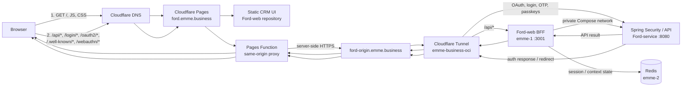

# Ford CRM hosting and request routing

## Decision

Keep the UI in the `Ford-web` repository and Spring backend in `Ford-service`. Deploy the UI to Cloudflare Pages at `ford.emme.business`. Use a Pages Function as a same-origin reverse proxy for authentication and API requests. A second hostname, `ford-origin.emme.business`, points through Cloudflare Tunnel to the private backend entry point on emme-1.

This keeps browser requests on one origin, so the browser does not need cross-origin API access or CORS exceptions. DNS only resolves names; Pages Functions and Tunnel ingress perform the HTTP routing.

## Request flow



## Hostnames and path ownership

| Public request | Cloudflare route | Destination | Purpose |
|---|---|---|---|
| `https://ford.emme.business/` and static assets | Pages custom domain | Cloudflare Pages assets | CRM UI |
| `https://ford.emme.business/api/*` | Pages Function → Tunnel path rule | BFF on emme-1:3001 | Session handling and application API via Ford-service |
| `https://ford.emme.business/oauth2/*` | Pages Function → Tunnel path rule | Spring on emme-1:8080 | OAuth authorization server |
| `https://ford.emme.business/.well-known/*` | Pages Function → Tunnel path rule | Spring on emme-1:8080 | OIDC discovery and metadata |
| `https://ford.emme.business/login/*`, `/logout`, `/webauthn/*` | Pages Function → Tunnel path rule | Spring on emme-1:8080 | Passkey and OTP sign-in endpoints |

The path list must match the actual Ford-service security routes and the Pages Function implementation. Do not proxy a path just because it appears in a design; verify it exists in the deployed OpenAPI/security configuration.

## Authentication and browser session

1. The browser loads the CRM from `ford.emme.business`.
2. The UI calls relative URLs such as `/api/...`; it does not call the Tunnel hostname directly.
3. Pages Function forwards API and auth-path requests server-side to `ford-origin.emme.business`.
4. Tunnel sends `/api/*` to the BFF, and auth endpoints (`/oauth2/*`, `/.well-known/*`, `/login/*`, `/logout`, `/webauthn/*`) directly to Spring. Spring remains the authentication owner; the BFF stores the browser session and calls protected APIs with server-held tokens.
5. The proxy must preserve required cookies and headers, and ensure redirects use the public `ford.emme.business` host. Internal origin URLs must not leak into browser redirects.

Whether access tokens stay entirely server-side depends on the implemented BFF/session contract. The proxy topology alone does not guarantee that; confirm cookie flags, token storage, CSRF protection, and refresh behavior in the actual code before production.

## DNS and Cloudflare responsibilities

| Record | Target | Used by |
|---|---|---|
| `ford.emme.business` | Cloudflare Pages custom-domain target for the `ford-crm-ui` project | Browser-facing UI and same-origin paths |
| `ford-origin.emme.business` | Tunnel target `07b1cb41-6306-4b35-9331-5078a7c102d8.cfargotunnel.com` | Pages Function’s server-side upstream |

Both records should be managed in the `emme.business` Cloudflare zone with proxying enabled where Cloudflare requires it. Add `ford.emme.business` as a custom domain in the Pages project. DNS by itself cannot route `/api` separately from `/`; Pages Functions send dynamic paths to the origin. Tunnel then splits those paths between the private BFF and Spring listeners on emme-1.

Expected Tunnel ingress shape (rules are evaluated top to bottom; keep the catch-all last):

```yaml
ingress:
  - hostname: ford-origin.emme.business
    path: ^/api/.*
    service: http://localhost:3001
  - hostname: ford-origin.emme.business
    path: ^/(oauth2|\.well-known|login|logout|webauthn)(/.*)?$
    service: http://localhost:8080
  - service: http_status:404
```

The BFF listens privately on emme-1 port `3001` and forwards approved application API requests to `ford-service:8080` over the private container network. Spring auth endpoints are reachable only through the Cloudflare Tunnel path rule; Spring itself is not exposed directly to the public Internet. Redis remains on its private network at emme-2. Cloudflare documents ordered ingress rules and regex path matching in its [Tunnel configuration reference](https://developers.cloudflare.com/tunnel/features/locally-managed-tunnels/configuration-file/).

## Deployment boundaries

- **Ford-web repo:** React UI, Pages Function proxy, BFF source/image, OpenAPI client/UI integration.
- **Ford-service repo:** Spring Security/authentication, API, persistence, deployment Compose/Ansible orchestration.
- **Cloudflare Pages:** serves static UI and executes the edge proxy function.
- **Cloudflare Tunnel:** connects the public origin hostname to private BFF and Spring listeners on emme-1, selected by request path.
- **DNS:** maps hostnames only; it is not a reverse proxy or path router.

Repos and deployments stay separate. The shared browser origin is provided by Pages Functions, not by placing both codebases in one repository or container.

## Current setup checklist

- [ ] Configure `ford.emme.business` as the `ford-crm-ui` Pages custom domain and point its DNS record to the Pages project.
- [ ] Create/verify `ford-origin.emme.business` Tunnel DNS record.
- [ ] Configure Tunnel ingress for `ford-origin.emme.business`: `/api/*` to BFF, OAuth/login/OTP/passkey routes to Spring.
- [ ] Set Pages project variable `FORD_ORIGIN_URL=https://ford-origin.emme.business`.
- [ ] Deploy the BFF image and Ford-service stack; confirm BFF health before switching traffic.
- [ ] Confirm each proxied auth/API path, cookie behavior, redirects, CSRF controls, and passkey/OTP flows against the deployed backend.
- [ ] Verify UI, API, login, logout, and passkey flows through `https://ford.emme.business` in a browser.

Until these items are verified, this document describes the target architecture, not proof that every production route is live.
