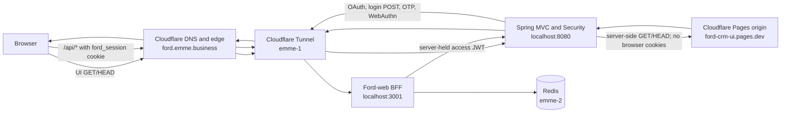

# Ford CRM hosting and request routing

## Decision

Keep React UI in `Ford-web` and Spring backend in `Ford-service`. Keep `ford.emme.business` as the browser origin, but route its DNS to the existing Cloudflare Tunnel. Spring serves the UI by reverse proxying safe page and asset requests to the independent Cloudflare Pages origin `ford-crm-ui.pages.dev`.

The browser stays on one origin for UI, BFF API, and authentication. The repositories and deployments remain separate. DNS selects the Tunnel; ordered Tunnel ingress rules route API traffic to the BFF and all other traffic to Spring. Spring then fetches UI documents/assets from Pages server-to-server.

## Request flow



## Path ownership

| Browser request | Tunnel route | Handler | Notes |
|---|---|---|---|
| `GET/HEAD /`, `/login`, application routes, assets | Catch-all `ford.emme.business` → Spring `:8080` | Spring UI proxy → Pages `ford-crm-ui.pages.dev` | Streams Pages response under the public origin; rewrites Pages-origin redirects. |
| `/api/*` | `ford.emme.business` → BFF `:3001` | Ford-web BFF | Browser `ford_session` cookie and CSRF header stay on this route. BFF keeps OAuth tokens server-side. |
| `POST /login`, `/login/ott`, `/logout`, `/webauthn/*`, `/oauth2/*`, `/.well-known/*` | Catch-all `ford.emme.business` → Spring `:8080` | Spring Security / Authorization Server | These routes never go to the Pages UI proxy; UI proxy accepts only GET/HEAD. |
| `/actuator/*`, `/webhooks/*` | Catch-all `ford.emme.business` → Spring `:8080` | Existing Spring handlers/security | Never proxied to Pages. |

The Spring UI proxy uses a fixed HTTPS Pages origin, forwards only selected representation/cache headers, does not forward browser cookies or authorization credentials, and passes through relevant response security headers. API and authentication routes are excluded. Spring already uses framework forwarded-header support and the configured `FORD_PUBLIC_BASE_URL` for public OAuth URLs.

## Cookie and header behavior

- The browser's opaque `ford_session` cookie is sent to `ford.emme.business/api/*`; Tunnel routes that request directly to the BFF. The Spring-to-Pages request never receives that cookie.
- BFF access and refresh tokens remain server-side in Redis. BFF-to-Spring API requests use bearer JWTs as before.
- Cloudflare's public HTTPS request reaches Spring through Tunnel. Spring's `server.forward-headers-strategy=framework` handles trusted forwarded host/protocol metadata, and `FORD_PUBLIC_BASE_URL=https://ford.emme.business` remains the canonical issuer/callback origin.
- A redirect from the Pages origin is rewritten to `ford.emme.business` before it reaches the browser. The browser does not navigate to `pages.dev` during the CRM flow.
- The Pages `pages.dev` hostname remains available as the independent UI upstream and for preview/direct access.

## DNS and Tunnel configuration

`ford.emme.business` is a proxied CNAME to the existing Tunnel target. Tunnel ingress rules are ordered, with the BFF path before the Spring catch-all:

```yaml
ingress:
  - hostname: ford.emme.business
    path: ^/api(/.*)?$
    service: http://localhost:3001
  - hostname: ford.emme.business
    service: http://localhost:8080
  - hostname: ford-origin.emme.business
    path: ^/api(/.*)?$
    service: http://localhost:3001
  - hostname: ford-origin.emme.business
    path: ^/(oauth2|\.well-known|login|logout|webauthn)(/.*)?$
    service: http://localhost:8080
  - hostname: ford-origin.emme.business
    service: http://localhost:8080
  - service: http_status:404
```

Keep `ford-origin.emme.business` available for rollback and diagnostic access during rollout. Once the new route is verified, remove `ford.emme.business` from the Pages custom-domain association; keep the Pages project and its `pages.dev` origin.

DNS only resolves hostnames. Cloudflare Tunnel ingress routes requests by hostname/path, and Spring performs the server-side UI proxy. Cloudflare documents [Tunnel DNS routing](https://developers.cloudflare.com/cloudflare-one/networks/connectors/cloudflare-tunnel/routing-to-tunnel/dns/) and [ordered ingress rules](https://developers.cloudflare.com/cloudflare-one/networks/connectors/cloudflare-tunnel/configure-tunnels/local-management/configuration-file/).

## Deployment boundaries

- **Ford-web repo:** React UI, Pages assets, BFF source/image, OpenAPI client, and the still-independent Pages deployment.
- **Ford-service repo:** Spring MVC UI proxy, Spring Security/authentication, APIs, and deployment configuration.
- **Cloudflare Pages:** static UI upstream at `ford-crm-ui.pages.dev`.
- **Cloudflare Tunnel:** public-to-private route for BFF and Spring on emme-1.
- **DNS:** maps `ford.emme.business` to the Tunnel; it does not perform path routing.

## Cutover checklist

- [ ] Deploy Spring proxy and verify `/login`, app route, asset, redirect rewrite, and Spring health through the diagnostic origin.
- [ ] Put `/api/*` Tunnel rule before the hostname catch-all; verify BFF session, CSRF, OIDC, and WebAuthn flows.
- [ ] Change `ford.emme.business` DNS CNAME to the Tunnel and enable Cloudflare proxying.
- [ ] Verify the public UI, API, OAuth redirects, and cookies remain on `ford.emme.business`.
- [ ] Remove the Pages custom-domain association only after public checks pass; keep `ford-crm-ui.pages.dev` deployed.
